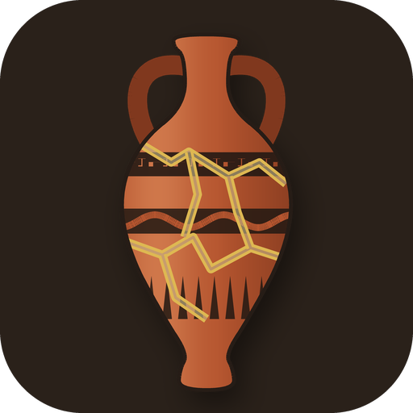
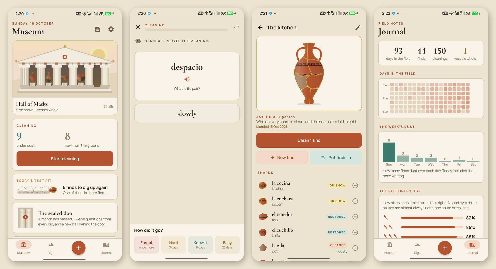
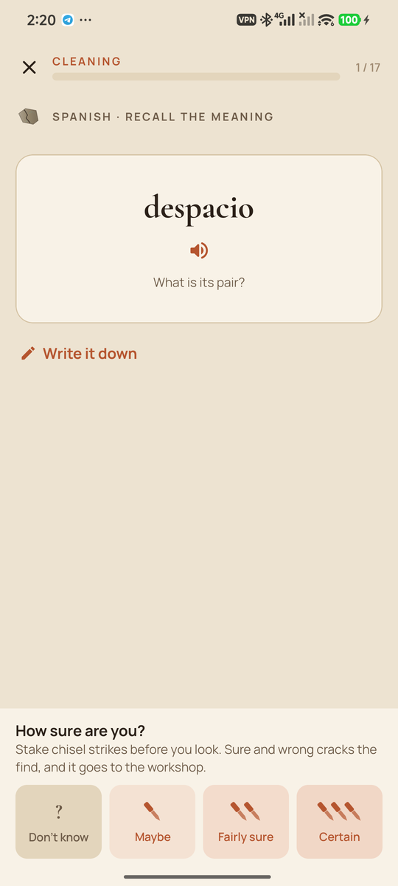
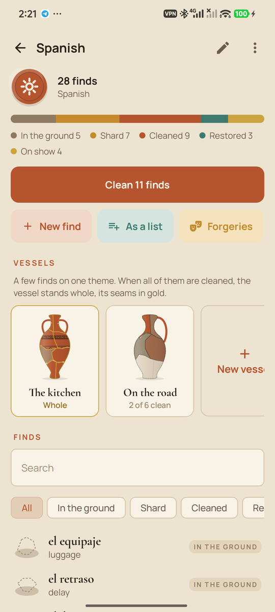
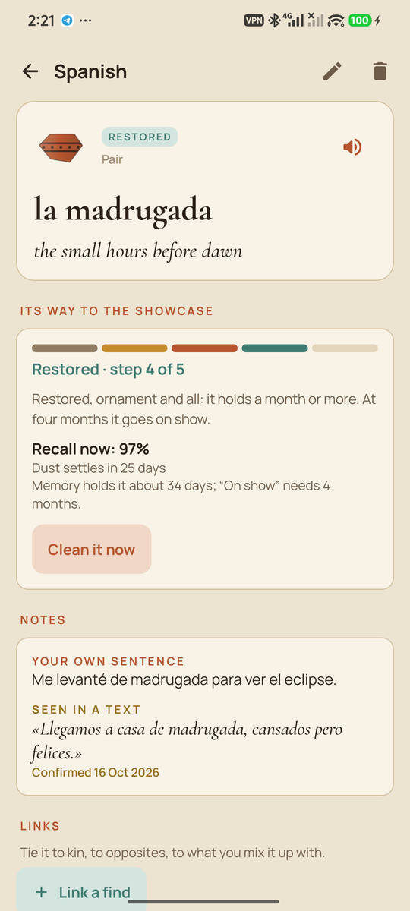
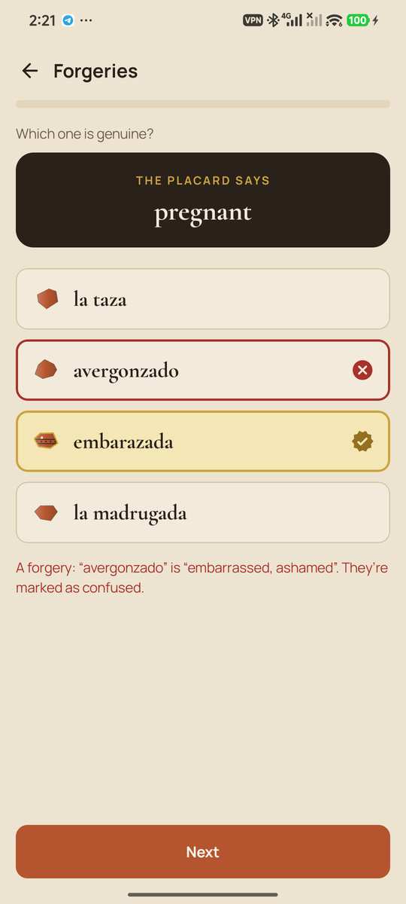
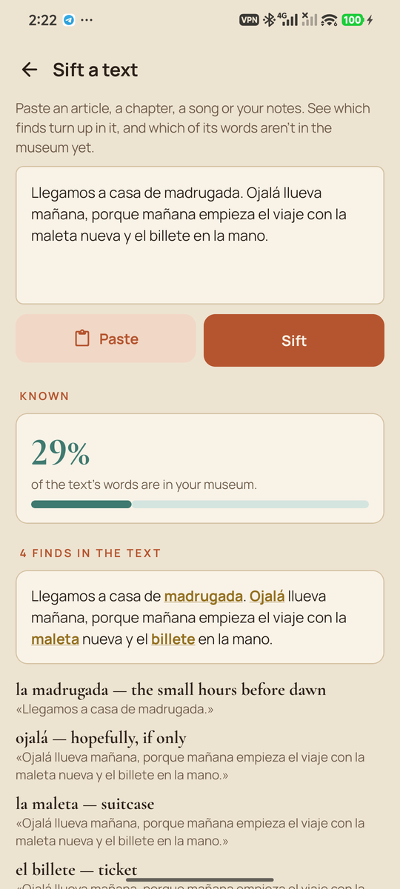
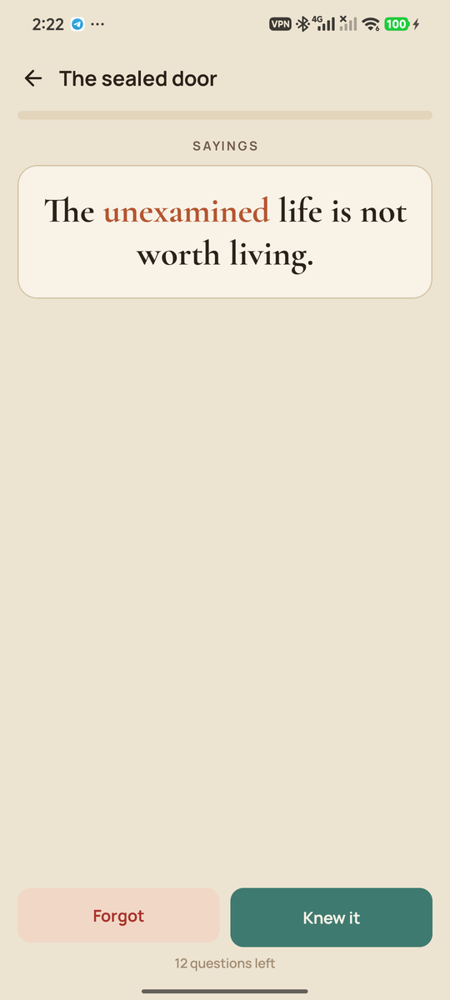
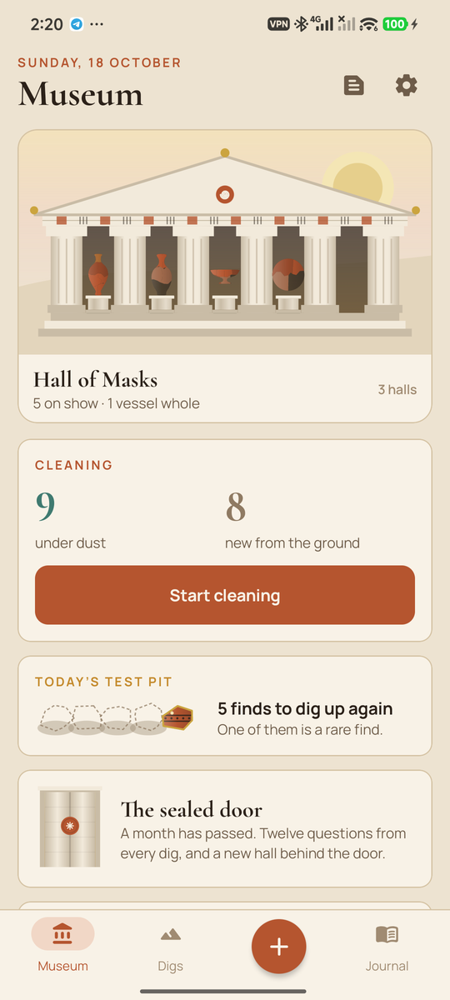
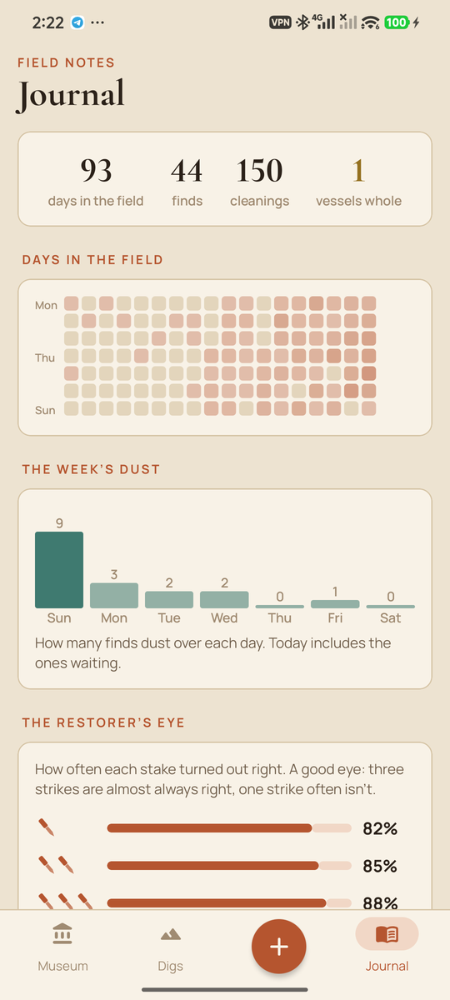

<div align="center">



# Stele

### Dig it up. Clean it. Put it on show.

*A museum for everything you want to remember. Words of a language, terms, formulas, dates, names, quotations: each is a find that you clean from dust along your forgetting curve, until it stands in the showcase. You fill the museum yourself. Free, no ads, no account.*

[](https://github.com/bigdevwhale/stele/actions/workflows/android.yml)
[](https://github.com/bigdevwhale/stele/releases/latest)


[](LICENSE)

**English** · [Русский](README.ru.md) · [Changelog](CHANGELOG.md)



</div>

---

## The idea

Flashcard apps work, but they feel like a pile of cards. Stele turns the same science (spaced retrieval) into archaeology. Everything you want to keep is a **find**. Each time you recall it, you brush the dust off. A find that memory holds longer moves up from a dusty shard to clean clay, then to painted, then to the showcase. Nothing is built in. The museum is yours to fill.

## How a find lives

1. **Dig it up.** Start a **dig** for each collection: a language, anatomy, work terms, capitals, quotations. A find can be a **pair** (casa — house), a **term** and its meaning, a **phrase** with [gaps] to fill, or a **question** and its answer. Optional extras: a sentence of your own, an association, where you met it, a picture from the phone's camera or gallery. You can add one by voice, select a word in any app and choose *Add to Stele*, use the quick-settings tile, type a whole list (`casa — house` per line), or import a CSV or an **Anki deck (.apkg)**.
2. **Dust settles.** Each find fades along its own forgetting curve (FSRS-4.5). A dusty find gathers a green patina, and the museum shows what is waiting.
3. **Clean it.** Recall it first, writing it down if you like (typos are forgiven). Then **stake one to three chisel strikes** on being right, and the brush sweeps the dust off the answer. Pairs are asked both ways, and in a language dig sometimes **by ear**, through the phone's own voice. Phrases are asked with their gaps covered.
4. **Five stages.** In the ground → shard → **cleaned** (holds a week) → **restored** with its painted ornament (a month) → **on show** (four months).
5. **Glue vessels.** Finds on one theme are shards of one **vessel**: an amphora, a krater, a mask, a coin, a tablet. When every shard is clean, the vessel stands whole, its seams laid in gold the way kintsugi mends a bowl.

## The learning science inside

| | Technique | In Stele |
|---|---|---|
| 🔁 | Retrieval practice and spacing | Cleanings scheduled by FSRS-4.5, at the retention you choose |
| 🔀 | Varied retrieval | Front to back, back to front, by ear, gaps in a phrase |
| ✍️ | Generation effect | A sentence of your own with each find; typed answers checked |
| ⛏️ | Metacognition, hypercorrection | Chisel strikes staked before looking; sure and wrong **cracks** the find into the **workshop**; **the restorer's eye** shows your calibration |
| 🎭 | Discrimination | **Forgeries**: the genuine find among look-alikes and the ones you mark as *confused with*. A mix-up is remembered as one |
| 🧩 | Chunking | **Vessels** gather a theme and are only whole when all of it is |
| 🔗 | Elaboration | Links between finds: kin, confused with, opposite |
| 🖼️ | Dual coding | A picture on a find |
| 🎓 | Interleaved testing | **The sealed door** once a month: twelve questions from every dig, no hints. Three in four right opens a new hall, and the museum front grows |
| 🕳️ | Desirable difficulty, reward | **Today's test pit**: a few finds you haven't seen for longest, and one rare find you've kept for months |
| 📰 | Transfer to real text | **Sift a text**: paste an article or share it from any app. See how much of it you know, confirm the finds met in it (they keep the real sentence), and take new words into a dig |

There are no streaks to lose. Dust is what tells you it's time. Russian addresses you as he or she, your choice.

## Screens

<table>
<tr>
<td></td>
<td></td>
<td></td>
<td></td>
</tr>
<tr>
<td></td>
<td></td>
<td></td>
<td></td>
</tr>
</table>

## Privacy

No account, no analytics, no ads, no network. Everything stays on the phone. A backup is one JSON file you save yourself, pictures included. Voice input and pronunciation use the phone's own recogniser and text-to-speech.

## Build

```bash
./gradlew assembleDebug                          # app.stele.dev
./gradlew assembleDebug -Pdemo                   # app.stele.demo with a museum half dug
./gradlew testDebugUnitTest -Prender [-Plang=ru] # draws the screens to app/build/art
bash tools/capture.sh <dir> en|ru                # phone screenshots of the -Pdemo -Pshots build
python tools/icon.py                             # the launcher icon and docs/logo.png
```

Kotlin, Jetpack Compose, Room, DataStore. Where things live:

- The forgetting curve: `domain/Memory.kt`.
- Stages, rounds, the test pit, the door, forgeries and sifting: `domain/Rules.kt`.
- Answer checking: `domain/Words.kt`.
- Anki import: `data/Anki.kt` (zstd via aircompressor).
- All the art is drawn in code in `ui/art`: vessels cut into shards, black-figure ornament, kintsugi seams, the temple front, the sealed door, the brush and its dust.

Cormorant and Manrope are under the SIL Open Font License.

## License

[MIT](LICENSE) · part of [Stillcraft](https://bigdevwhale.github.io/stillcraft/)
