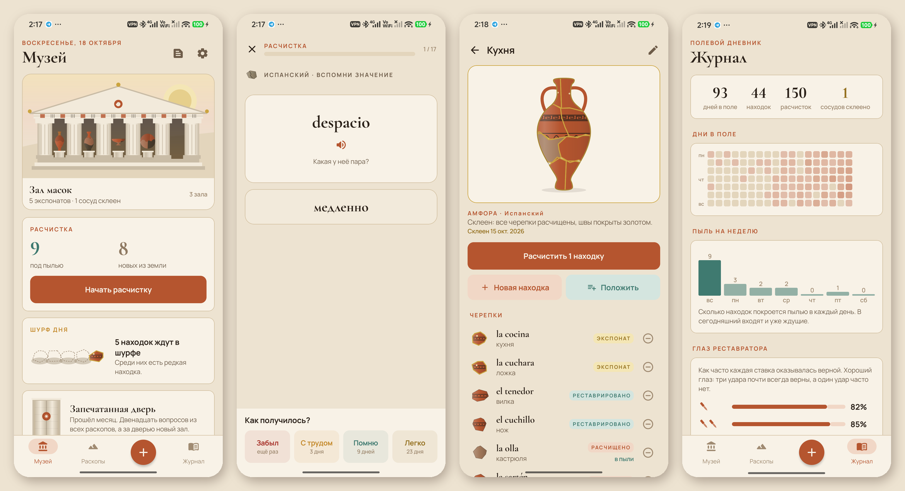
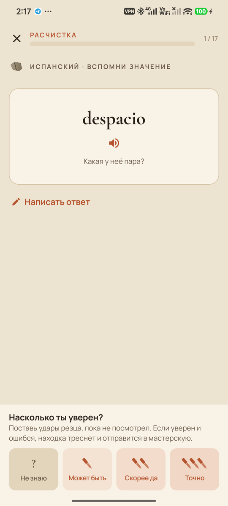
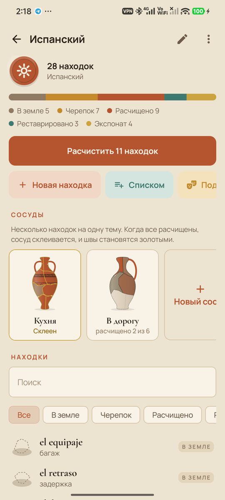
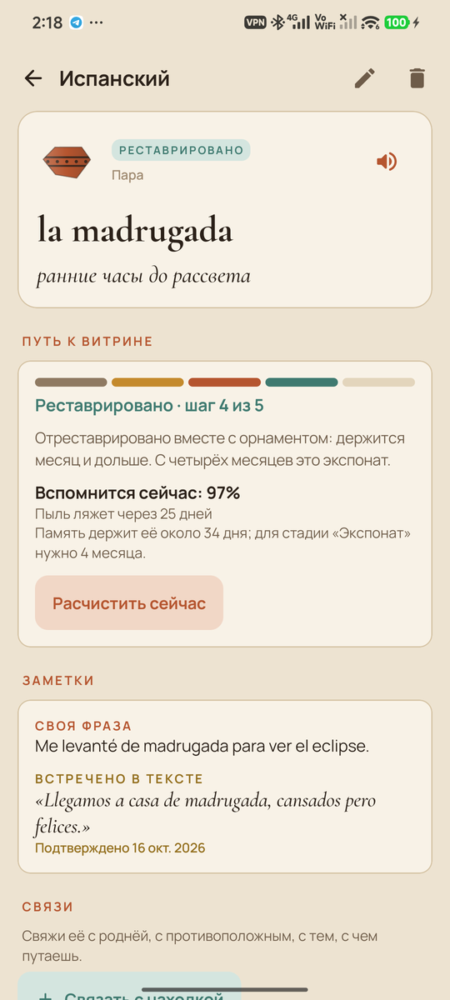
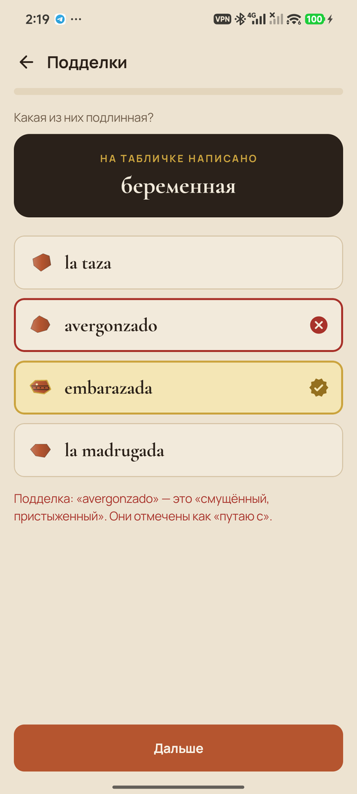
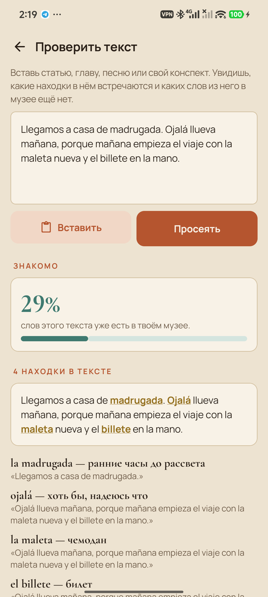
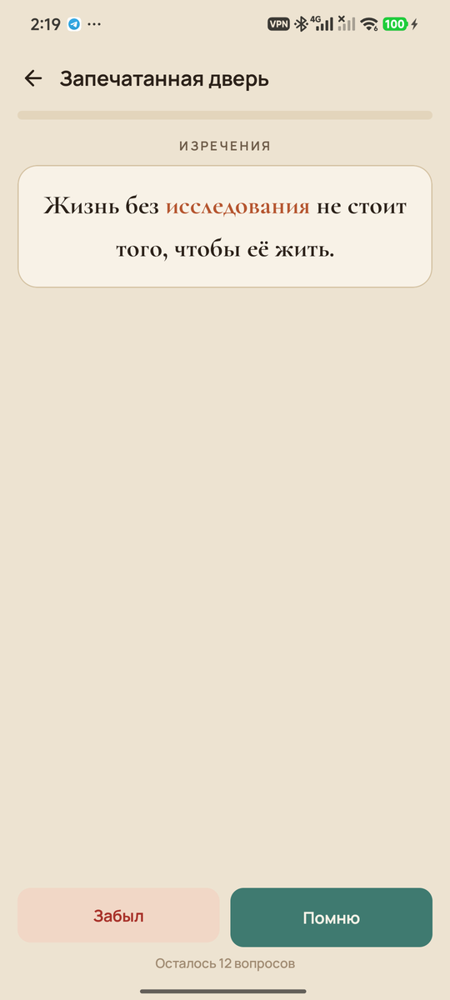
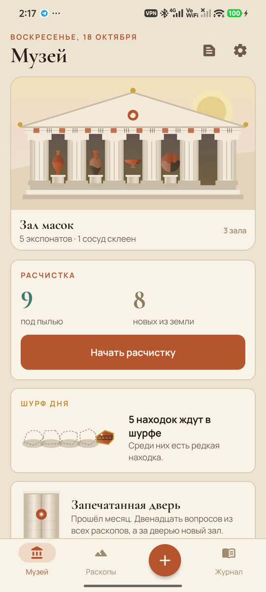
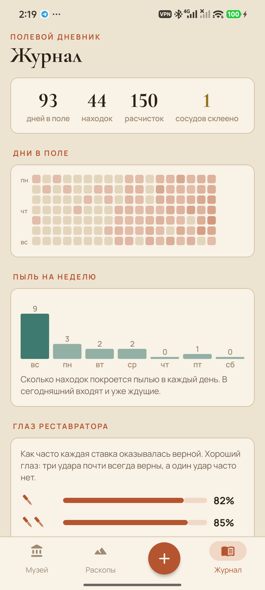

<div align="center">


# Стела

### Откопай. Расчисти. Выставь в витрину.

*Музей для всего, что хочешь помнить. Слова чужого языка, термины, формулы, даты, имена, цитаты. Каждая такая вещь здесь находка: ты расчищаешь её от пыли по своей кривой забывания, пока она не встанет в витрину. Музей заполняешь сам. Бесплатно, без рекламы и аккаунта.*

[](https://github.com/bigdevwhale/stele/actions/workflows/android.yml)
[](https://github.com/bigdevwhale/stele/releases/latest)


[](LICENSE)

[English](README.md) · **Русский** · [Изменения](CHANGELOG.md)



</div>

---

## Идея

Карточки работают, но ощущаются как стопка бумажек. Стела превращает ту же науку (интервальное вспоминание) в археологию. Всё, что хочешь сохранить, становится **находкой**. Каждый раз, когда ты её вспоминаешь, ты смахиваешь с неё пыль. Чем дольше память её держит, тем выше она поднимается: от пыльного черепка к чистой глине, потом к росписи и к витрине. Готового ничего нет. Музей заполняешь ты.

## Как живёт находка

1. **Откопай.** Заведи **раскоп** на каждую коллекцию: язык, анатомию, термины с работы, столицы, цитаты. Находка может быть **парой** (casa — дом), **термином** со значением, **фразой** с [пропусками] или **вопросом** с ответом. По желанию к ней можно добавить свою фразу, ассоциацию, отметку «где встретил» и картинку с камеры телефона или из галереи. Добавлять можно голосом, выделив слово в любом приложении и выбрав *В Стелу*, плиткой в шторке, целым списком (`casa — дом` на строку), из CSV или **колоды Anki (.apkg)**.
2. **Ложится пыль.** Каждая находка тускнеет по своей кривой забывания (FSRS-4.5). Запылённая покрывается зелёной патиной, и музей сам показывает, что ждёт.
3. **Расчисти.** Сначала вспомни сам, можно записать ответ: опечатки прощаются. Потом **поставь от одного до трёх ударов резца** на то, что прав, и кисть сметёт пыль с ответа. Пары спрашиваются в обе стороны, а в языковом раскопе иногда **на слух**, голосом самого телефона. Во фразах закрыты пропуски.
4. **Пять стадий.** В земле → черепок → **расчищено** (держится неделю) → **реставрировано**, с росписью (месяц) → **экспонат** (четыре месяца).
5. **Склеивай сосуды.** Находки на одну тему — черепки одного **сосуда**: амфоры, кратера, маски, монеты, таблички. Когда все черепки чистые, сосуд склеивается, и его швы покрываются золотом, как в кинцуги.

## Наука внутри

| | Техника | В Стеле |
|---|---|---|
| 🔁 | Активное вспоминание и интервалы | Расчистки по FSRS-4.5 с выбранным тобой порогом удержания |
| 🔀 | Разные способы вспоминания | С лица на оборот, с оборота на лицо, на слух, пропуски во фразе |
| ✍️ | Эффект генерации | Своя фраза к каждой находке, проверка напечатанного ответа |
| ⛏️ | Метапознание, гиперкоррекция | Удары резца до ответа; после уверенной ошибки находка **трескается** и уходит в **мастерскую**; **глаз реставратора** показывает калибровку |
| 🎭 | Различение | **Подделки**: подлинная находка среди похожих и тех, что ты пометил «путаю с». Путаница запоминается как связь |
| 🧩 | Группировка | **Сосуды** собирают тему и склеиваются, только когда расчищена вся |
| 🔗 | Элаборация | Связи между находками: родня, путаю с, противоположное |
| 🖼️ | Двойное кодирование | Картинка на находке |
| 🎓 | Перемешанная проверка | **Запечатанная дверь** раз в месяц: двенадцать вопросов из всех раскопов без подсказок. Три верных из четырёх открывают новый зал, и фасад музея растёт |
| 🕳️ | Желательная трудность, награда | **Шурф дня**: несколько давно не виденных находок и одна редкая, которую ты держишь месяцами |
| 📰 | Перенос в живой текст | **Проверить текст**: вставь статью или поделись ей из любого приложения. Увидишь, какую долю ты уже знаешь, подтвердишь встреченные находки (они сохранят настоящее предложение) и заберёшь новые слова в раскоп |

Стриков, которые можно потерять, нет: о том, что пора, говорит пыль. По-русски приложение обращается к тебе в мужском или женском роде, как выберешь.

## Экраны

<table>
<tr>
<td></td>
<td></td>
<td></td>
<td></td>
</tr>
<tr>
<td></td>
<td></td>
<td></td>
<td></td>
</tr>
</table>

## Приватность

Ни аккаунта, ни аналитики, ни рекламы, ни сети. Всё хранится на телефоне. Резервная копия — один JSON-файл, который ты сохраняешь сам, вместе с картинками. Голосовой ввод и произношение работают через распознаватель и синтез речи самого телефона.

## Сборка

```bash
./gradlew assembleDebug                          # app.stele.dev
./gradlew assembleDebug -Pdemo                   # app.stele.demo с наполовину раскопанным музеем
./gradlew testDebugUnitTest -Prender [-Plang=ru] # рисует экраны в app/build/art
bash tools/capture.sh <dir> en|ru                # скриншоты с телефона из сборки -Pdemo -Pshots
python tools/icon.py                             # иконка и docs/logo.png
```

Kotlin, Jetpack Compose, Room, DataStore. Что где лежит:

- Кривая забывания: `domain/Memory.kt`.
- Стадии, раунды, шурф, дверь, подделки и просеивание текста: `domain/Rules.kt`.
- Проверка ответов: `domain/Words.kt`.
- Импорт Anki: `data/Anki.kt` (zstd через aircompressor).
- Вся графика нарисована в коде, в `ui/art`: сосуды, разрезанные на черепки, чернофигурный орнамент, золотые швы, фасад храма, запечатанная дверь, кисть и её пыль.

Шрифты Cormorant и Manrope распространяются по SIL Open Font License.

## Лицензия

[MIT](LICENSE) · часть [Stillcraft](https://bigdevwhale.github.io/stillcraft/)
